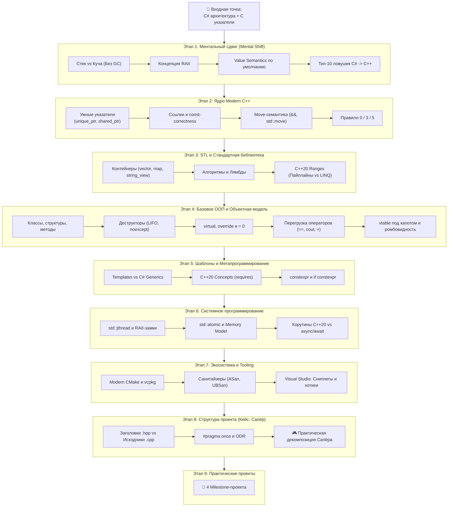

# 🚀 Modern C++ Roadmap для C# / C Разработчиков

> Этот репозиторий — специализированный интерактивный роадмап и справочник по переходу на **Modern C++ (C++20 / C++23)** для тех, у кого уже есть опыт в **C#** (архитектура, ООП, generics, LINQ) и базовые знания **C** (указатели, адресация, ручное управление памятью).

---

## 🗺️ Карта изучения (Roadmap Graph)

---

## 📑 Содержание и учебные модули

Каждый модуль содержит теоретическое объяснение, разбор подводных камней, живые примеры кода и прямые параллели с C#:

| Раздел | Модуль | Ключевые темы |
| :--- | :--- | :--- |
| **01. Mental Shift** | [01. Память без GC и RAII](01-mental-shift/01-memory-and-raii.md) | Стек vs Куча, детерминированные деструкторы, аналог `IDisposable` |
| | [02. Value Semantics vs Ссылки](01-mental-shift/02-value-vs-reference.md) | Копирование по умолчанию, ссылки `&`, `const &`, висячие ссылки |
| | [03. Топ-10 подводных камней](01-mental-shift/03-pitfalls-cs-to-cpp.md) | Ловушки `new`, `struct` vs `class`, срезка объектов, мусор в памяти |
| **02. Modern Core** | [01. Умные указатели](02-modern-cpp-core/01-smart-pointers.md) | `unique_ptr`, `shared_ptr`, `weak_ptr`, циклические зависимости |
| | [02. Ссылки, const и constexpr](02-modern-cpp-core/02-references-and-const.md) | `const`-методы, правило чтения указателей, compile-time вычисления |
| | [03. Move-семантика и Rule of 5](02-modern-cpp-core/03-move-semantics-and-rule-of-5.md) | Lvalue/Rvalue, `&&`, `std::move`, Rule of 0/3/5, `noexcept` |
| **03. STL & Ranges**| [01. Контейнеры STL](03-stl-and-standard-library/01-containers.md) | `vector` deep-dive, SSO в строках, `string_view`, `span` |
| | [02. Алгоритмы и Лямбды](03-stl-and-standard-library/02-algorithms-and-lambdas.md) | Итераторы, списки захвата `[&]`, `[=]`, `<algorithm>` |
| | [03. C++20 Ranges vs C# LINQ](03-stl-and-standard-library/03-ranges-vs-linq.md) | Оператор `\|`, `views::filter`, `views::transform`, 0-cost абстракции |
| **04. Object Model & OOP**| [00. Классы и методы (без зауми)](04-object-model-and-oop/00-classes-and-methods-basics.md) | Синтаксис класса, `;` на конце, список инициализации, `const`-методы |
| | [01. Деструкторы от А до Я](04-object-model-and-oop/01-destructors-guide.md) | Детерминированность, порядок LIFO, виртуальный деструктор, `noexcept` |
| | [02. Наследование и override](04-object-model-and-oop/02-inheritance-and-override-basics.md) | `: public`, вызов базового конструктора, `virtual`, `override`, `= 0` |
| | [03. Перегрузка операторов](04-object-model-and-oop/03-operator-overloading-basics.md) | Вывод в `std::cout <<`, `operator==`, `operator+`, Spaceship `<=>` |
| | [04. Полиморфизм и vtable](04-object-model-and-oop/04-polymorphism-and-vtable.md) | Устройство памяти объекта, `vptr`, вызовы функций под капотом |
| | [05. Множественное наследование](04-object-model-and-oop/05-multiple-inheritance.md) | Интерфейсы в C++, ромбовидное наследование, `dynamic_cast` |
| **05. Templates** | [01. Шаблоны vs Дженерики](05-templates-and-generics/01-templates-vs-generics.md) | Кодогенерация vs IL, специализация, почему шаблоны пишут в `.hpp` |
| | [02. C++20 Концепты](05-templates-and-generics/02-concepts-and-constexpr.md) | Ограничения `requires` vs `where T : ...`, `if constexpr` |
| **06. Concurrency** | [01. Потоки и Атомики](06-concurrency-and-systems/01-threads-and-atomics.md) | `std::jthread`, `std::scoped_lock`, атомики, Data Race = UB |
| | [02. Корутины vs Async/Await](06-concurrency-and-systems/02-coroutines-vs-async.md) | `co_await`, `co_yield`, stackless state machine, `std::generator` |
| **07. Tooling** | [01. Руководство по CMake](07-tooling-and-ecosystem/01-cmake-guide.md) | Target-based CMake, `CMakeLists.txt`, команды сборки |
| | [02. Санитайзеры и vcpkg](07-tooling-and-ecosystem/02-sanitizers-and-debug.md) | AddressSanitizer (ASan), UBSan, пакетный менеджер vcpkg |
| | [03. Сниппеты и хоткеи VS](07-tooling-and-ecosystem/03-visual-studio-snippets-and-tricks.md) | `Alt+O`, `Surround with`, свои XML-сниппеты, генерация методов |
| **08. Structure & Headers** | [01. Разделение на .hpp и .cpp](09-project-structure-and-headers/01-headers-vs-sources-guide.md) | `#pragma once`, почему нельзя тело в .h, Forward Declaration |
| | [02. Архитектура Сапёра](09-project-structure-and-headers/02-minesweeper-architecture.md) | Декомпозиция: Cell, Board, Game, чистая архитектура без спагетти |
| | [03. Пошаговый разбор кода](09-project-structure-and-headers/03-minesweeper-code-walkthrough.md) | 1D-вектор вместо 2D, Flood-Fill очередь, безопасный первый ход |
| | [🎮 Исходный код Сапёра](examples/minesweeper/) | Готовый модульный проект на C++20 с `CMakeLists.txt` |
| **09. Projects** | [🎯 4 Практических проекта](08-practice-projects/projects-guide.md) | Свой Vector, Zero-Copy парсер логов, Thread Pool, Mini-Redis |

---

## ⚡ Экспресс-переводчик ментальных моделей (C# ➔ C++)

| В C# (.NET) | В C++ (Modern C++20) | Что важно помнить |
| :--- | :--- | :--- |
| `class Foo { }` | `class Foo { };` | Обязательно точка с запятой в конце! |
| `var x = new Foo();` | `Foo x;` (стек) или `auto x = std::make_unique<Foo>();` (куча) | Забудьте про `new Foo()`! Стек всегда в приоритете. |
| `using (var r = ...)` | Автоматически через RAII `{ Resource r; ... }` | Деструктор вызовется сам при закрытии фигурной скобки. |
| `ReadOnlySpan<char>` | `std::string_view` | Нулевая стоимость, не владеет строкой. |
| `ref int x` | `int& x` | Ссылку нельзя перепривязать или сделать `nullptr`. |
| `in T x` | `const T& x` | Золотой стандарт для передачи тяжелых объектов. |
| `List<T>` | `std::vector<T>` | Используйте `.reserve()`, чтобы избежать лишних аллокаций. |
| `Dictionary<K, V>` | `std::unordered_map<K, V>` | `map[k]` создаст дефолтный элемент, если ключа нет. |
| `LINQ (.Where.Select)`| `std::views::filter \| std::views::transform` | Вычисляется лениво и без аллокаций в куче. |
| `where T : IFoo` | `template <typename T> requires FooConcept<T>` | Проверяется во время компиляции через C++20 Concepts. |
| `Task.Run` / `Thread` | `std::jthread` | Автоматически делает `.join()` при выходе из скобок. |
| `lock (syncObj)` | `std::scoped_lock lock(mtx);` | Захватывает мьютекс и отпускает в деструкторе. |

---

## 🛠️ Настройка рабочего окружения на Windows

1. **Компилятор:**
   * Установите **Visual Studio Community** (выберите рабочую нагрузку *"Разработка классических приложений на C++"* — включает компилятор MSVC, CMake и Windows SDK).
   * Либо установите **LLVM Clang** (`winget install LLVM.LLVM`).
2. **IDE / Редактор:**
   * **Visual Studio 2022** — отличная поддержка CMake, лучший визуальный дебаггер и профилировщик под Windows.
   * **VS Code** — установите плагины: `C/C++ Extension Pack`, `CMake Tools`.
   * **CLion / Rider for C++** — первоклассный рефакторинг и статический анализ.

---

## 📚 Рекомендуемый порядок изучения (План на 6-8 недель)

* **Неделя 1:** Модули `01-mental-shift` и `02-modern-cpp-core`. Начните писать на C++ без использования `new` и `malloc`.
* **Неделя 2:** Реализация **Milestone 1 (`MyVector<T>`)**. Понимание Rule of 5 и move-семантики на практике.
* **Неделя 3:** Модуль `03-stl-and-standard-library`. Работа с `std::string_view`, алгоритмами и Ranges.
* **Неделя 4:** Реализация **Milestone 2 (Zero-Copy Log Parser)**. Измерение разницы в производительности с C#.
* **Неделя 5:** Модули `04-object-model-and-oop` и `05-templates-and-generics`. Освоение C++20 Concepts.
* **Неделя 6:** Модули `06-concurrency` и `07-tooling`. Реализация **Milestone 3 (Thread Pool)**.
* **Неделя 7-8:** Итоговый проект **Milestone 4 (Mini-Redis)** с сетевым взаимодействием и тестами.
